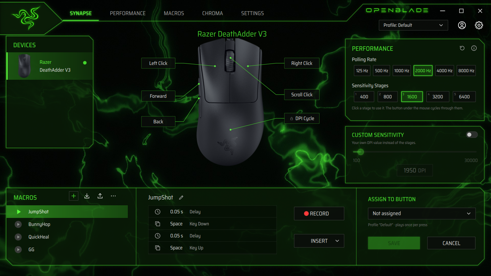
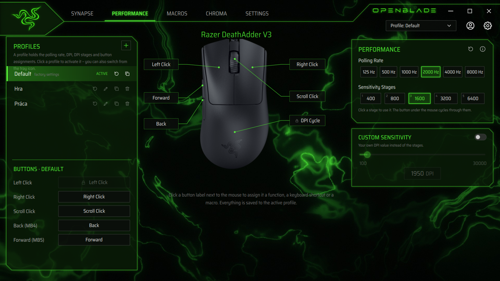
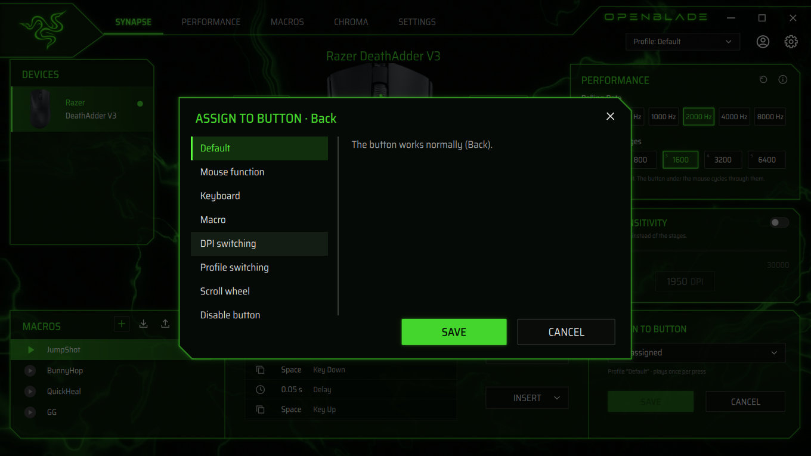
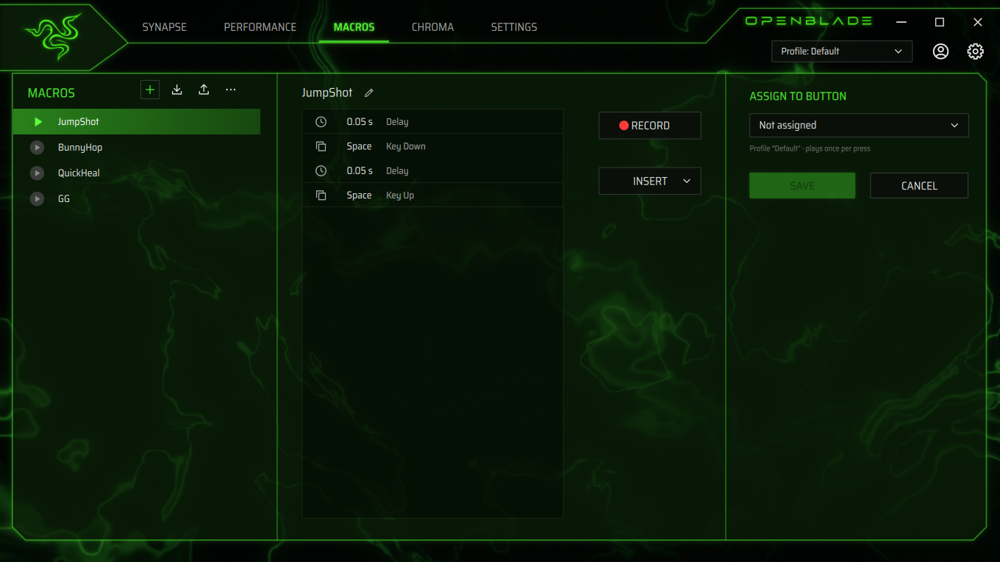

<p align="center">
  
</p>

<h1 align="center">OpenBlade-Synapse</h1>

<p align="center">
  A Razer Synapse–style configurator for Razer mice on Linux, built on top of <a href="https://openrazer.github.io/">OpenRazer</a>.<br>
  DPI, polling rate, profiles, button remapping and macros – in a neon UI, written in Rust.
</p>

<p align="center">
  <a href="https://github.com/rLTplay3r/OpenBlade-Synapse/releases/latest"><b>Download</b></a> ·
  <a href="#install">Install</a> ·
  <a href="#build-from-source">Build from source</a> ·
  <a href="#how-it-works">How it works</a>
</p>



> **Unofficial.** OpenBlade-Synapse is not affiliated with, endorsed by or a product of Razer Inc.
> “Razer”, “Synapse” and product names are trademarks of Razer Inc.

## Features

| | |
|---|---|
| **All OpenRazer mice** | 86 models / 113 USB variants – every mouse [OpenRazer supports](https://openrazer.github.io/#devices). Product images, max DPI and settable polling rates come from OpenRazer. |
| **Polling rate** | Exactly the rates your mouse supports (125 – 8000 Hz). |
| **Sensitivity stages** | The model's **factory DPI stages**, researched per model from official Razer sources (master guides, razer.com, Razer support). Click to switch; the DPI button under the mouse keeps working. |
| **Custom sensitivity** | One free DPI value (100 – max DPI) instead of the stages, with a slider or typed in. |
| **Profiles** | *Default* (factory settings) + your own profiles; switch from the window or the tray. Reset a profile or everything to factory values. |
| **Programmable buttons** | Right / middle / back / forward → another mouse button, a key or shortcut, a macro, DPI up/down/cycle, next profile, scroll up/down, or disabled. |
| **Macros** | Record from the keyboard (with delays), insert and edit steps, play once / while held / toggle, import & export (JSON). |
| **Tray** | Profile, DPI stage / custom sensitivity and polling rate right from the system tray. |
| **9 languages** | English, Slovenčina, Čeština, Polski, Deutsch, Español, Русский, 中文, 日本語 – switch live in Settings. |
| **Lightweight** | Native Rust. When the window is closed only a small service stays running (~8 MB RAM, 0 % CPU idle). |

<p align="center">
  
  
</p>
<p align="center">
  
</p>

## Install

### 1. OpenRazer + dependencies (copy & paste for your distribution)

One block per distribution. It installs the **OpenRazer** driver and daemon and the **Qt 6 / Qt Quick** libraries the
window needs, allows button remapping (access to `/dev/uinput` for the logged-in user – the same rule Steam and
KDE Connect use) and adds you to the `plugdev` group. OpenRazer commands are taken from
[openrazer.github.io](https://openrazer.github.io/#download). **Reboot afterwards** (driver, group and rule take effect).

<details open>
<summary><b>Fedora / Nobara</b> (41 and newer)</summary>

```bash
sudo dnf install -y kernel-devel qt6-qtdeclarative && \
sudo dnf config-manager addrepo --from-repofile=https://openrazer.github.io/hardware:razer.repo && \
sudo dnf install -y openrazer-meta && \
echo 'KERNEL=="uinput", SUBSYSTEM=="misc", TAG+="uaccess", OPTIONS+="static_node=uinput"' | sudo tee /etc/udev/rules.d/70-openblade-uinput.rules >/dev/null && \
sudo gpasswd -a $USER plugdev
```
With **Secure Boot** enabled, run [`install-openrazer.sh`](install-openrazer.sh) first – it also enrolls the module
signing key – and then this block.
</details>

<details>
<summary><b>Arch Linux / Manjaro / EndeavourOS</b></summary>

```bash
sudo pacman -S --needed linux-headers openrazer-daemon qt6-declarative && \
echo 'KERNEL=="uinput", SUBSYSTEM=="misc", TAG+="uaccess", OPTIONS+="static_node=uinput"' | sudo tee /etc/udev/rules.d/70-openblade-uinput.rules >/dev/null && \
sudo gpasswd -a $USER plugdev
```
Use the headers package matching your kernel (`linux-lts-headers`, `linux-zen-headers`, …).
</details>

<details>
<summary><b>Ubuntu / Kubuntu / Linux Mint / Pop!_OS / Zorin / elementary</b></summary>

```bash
sudo add-apt-repository -y ppa:openrazer/stable && sudo apt update && \
sudo apt install -y openrazer-meta && \
echo 'KERNEL=="uinput", SUBSYSTEM=="misc", TAG+="uaccess", OPTIONS+="static_node=uinput"' | sudo tee /etc/udev/rules.d/70-openblade-uinput.rules >/dev/null && \
sudo gpasswd -a $USER plugdev
```
Ubuntu **25.04 and newer** – also the Qt libraries for the prebuilt folder:
```bash
sudo apt install -y qml6-module-qtquick qml6-module-qtquick-controls qml6-module-qtquick-dialogs \
  qml6-module-qtquick-effects qml6-module-qtquick-shapes qml6-module-qtquick-layouts qml6-module-qtquick-window \
  qml6-module-qtquick-templates qml6-module-qtqml-workerscript
```
Ubuntu **22.04 / 24.04** and the distributions based on them (Linux Mint 21/22, Pop!_OS 22.04/24.04, Zorin 17,
elementary 7/8) ship Qt 6.2 / 6.4, which is too old for the prebuilt folder (Qt ≥ 6.6 is needed).
Use the [AppImage](#appimage) there – it brings its own Qt, so the Qt packages are not needed.
</details>

<details>
<summary><b>Debian</b> (13 “trixie” and newer)</summary>

```bash
sudo apt install -y openrazer-meta qml6-module-qtquick qml6-module-qtquick-controls qml6-module-qtquick-dialogs \
  qml6-module-qtquick-effects qml6-module-qtquick-shapes qml6-module-qtquick-layouts qml6-module-qtquick-window \
  qml6-module-qtquick-templates qml6-module-qtqml-workerscript && \
echo 'KERNEL=="uinput", SUBSYSTEM=="misc", TAG+="uaccess", OPTIONS+="static_node=uinput"' | sudo tee /etc/udev/rules.d/70-openblade-uinput.rules >/dev/null && \
sudo gpasswd -a $USER plugdev
```
Debian 12 has Qt 6.4 – use the [AppImage](#appimage).
</details>

<details>
<summary><b>openSUSE Tumbleweed</b></summary>

```bash
sudo zypper addrepo https://download.opensuse.org/repositories/hardware:razer/openSUSE_Tumbleweed/hardware:razer.repo && \
sudo zypper refresh && sudo zypper install openrazer-meta qt6-declarative-imports && \
sudo systemctl enable --now dkms.service && \
echo 'KERNEL=="uinput", SUBSYSTEM=="misc", TAG+="uaccess", OPTIONS+="static_node=uinput"' | sudo tee /etc/udev/rules.d/70-openblade-uinput.rules >/dev/null && \
sudo gpasswd -a $USER plugdev
```
</details>

<details>
<summary>Other distributions</summary>

Install OpenRazer as described on [openrazer.github.io](https://openrazer.github.io/#download)
(Gentoo, NixOS, Solus, Void, Alpine, …) plus your distribution's Qt 6 Qt Quick (QML) packages, version 6.6 or newer
(or use the [AppImage](#appimage)). For button remapping add the `uinput` rule from the blocks above.
On NixOS the group is `openrazer` instead of `plugdev`.
</details>

### 2. OpenBlade-Synapse

<a id="appimage"></a>
#### AppImage (recommended)

A single file that brings its own Qt 6.11, so it also runs on older distributions (glibc ≥ 2.35: Ubuntu 22.04+,
Linux Mint 21+, Pop!_OS 22.04+, Debian 12+, …).

1. Download `OpenBlade-Synapse-<version>-x86_64.AppImage` from [**Releases**](https://github.com/rLTplay3r/OpenBlade-Synapse/releases/latest).
2. Make it executable: right-click → *Properties* → *Executable*, or `chmod +x OpenBlade-Synapse-*.AppImage`.
3. Double-click it. On its first start it adds itself to the application menu.

To remove it, delete the file (and `~/.local/share/applications/openblade-synapse.desktop`).

#### Classic download (folder)

If you prefer a plain folder, the same release also has `OpenBlade-Synapse-<version>-linux-x86_64.tar.gz`:

1. Download it from [**Releases**](https://github.com/rLTplay3r/OpenBlade-Synapse/releases/latest) and extract it anywhere (e.g. `~/Applications`).
2. Run `install.sh` in the extracted folder once – it adds **OpenBlade-Synapse** to your application menu
   (no root needed; the program stays in that folder). Or just double-click `OpenBlade-Synapse`.

`uninstall.sh` removes the menu and autostart entries; delete the folder to remove the program.
The folder uses the system's Qt: it needs glibc ≥ 2.39 and **Qt ≥ 6.6** with Qt Quick (the Qt packages from step 1).
It is built and tested with Qt 6.11 on Fedora 45 / KDE Plasma; on older distributions use the AppImage.

Either way, settings live in `~/.config/openblade-synapse/`. The tray icon uses StatusNotifierItem (works out of the box
on KDE; on GNOME you need the AppIndicator extension).

## Build from source

You need Rust, a C++ compiler and the Qt 6 development files (the window uses [CXX-Qt](https://github.com/KDAB/cxx-qt)).

| Distribution | Packages |
|---|---|
| Fedora | `sudo dnf install gcc-c++ qt6-qtbase-devel qt6-qtdeclarative-devel` (or run [`install-rust-deps.sh`](install-rust-deps.sh)) |
| Arch | `sudo pacman -S base-devel qt6-base qt6-declarative` |
| Debian / Ubuntu | `sudo apt install build-essential qt6-base-dev qt6-declarative-dev` |
| Rust | [rustup.rs](https://rustup.rs) |

```bash
git clone https://github.com/rLTplay3r/OpenBlade-Synapse.git
cd OpenBlade-Synapse
./build.sh             # -> dist/OpenBlade-Synapse/ (self-contained folder)
./build.sh --install   # ... and add it to the application menu
```

Tests: `cd rust && cargo test`.

To build the **AppImage** yourself you need **podman** or **docker**; the build runs in an Ubuntu 22.04 container
([`packaging/appimage/`](packaging/appimage)), the first run downloads the build environment (a few GB):
```bash
packaging/appimage/make-appimage.sh   # -> dist/OpenBlade-Synapse-v<version>-x86_64.AppImage
```

## How it works

```
 ┌──────────────────────────────┐  Unix socket   ┌───────────────────────────────────────┐
 │ openblade-synapse-gui        │  (JSON lines)  │ OpenBlade-Synapse  (daemon, no Qt)    │
 │ Rust + Qt Quick (CXX-Qt)     │ ◄────────────► │ profiles · tray (StatusNotifierItem)  │
 │ app/qml – the UI             │                │ button remapping + macros             │
 │ runs only while it is open   │                │ always running, ~8 MB                 │
 └──────────────────────────────┘                └──────────────┬────────────────────────┘
                                                                │ D-Bus (org.razer)
                                                 ┌──────────────▼────────────────────────┐
                                                 │ OpenRazer daemon + kernel driver      │
                                                 └───────────────────────────────────────┘
```

- **`OpenBlade-Synapse`** is what you start. It is a single instance: starting it again just opens the window.
  It owns the settings, talks to the OpenRazer daemon over D-Bus and shows the tray icon.
- **`openblade-synapse-gui`** is the window. Closing it ends the process – nothing of the UI stays in memory.
- **Button remapping:** only when the active profile changes a button, the daemon grabs the mouse (`EVIOCGRAB`) and
  forwards every event through a virtual mouse (`/dev/uinput`) with the same name, so your desktop's pointer settings
  still apply. With no remapped buttons the mouse is never grabbed. The left button cannot be remapped (so you never
  lose clicking). The DPI button under the mouse is handled by the mouse firmware.
- **Mouse database** (`app/devices/`): `openrazer_mice.json` is generated from OpenRazer
  ([`tools/extract_openrazer_mice.py`](tools/extract_openrazer_mice.py)); `factory.json` holds factory DPI stages and
  defaults with their sources (built from [`tools/research/`](tools/research) by
  [`tools/build_factory.py`](tools/build_factory.py)). Where Razer never published a model's stages, the stages the
  mouse reports are used; an undocumented default stage is shown with “?”.
- Product images are downloaded on first use from Razer's CDN (the same URLs OpenRazer uses) and cached in
  `~/.cache/openblade-synapse`.

### Repository layout

| Path | |
|---|---|
| `rust/obcore` | shared code: key names, mouse database, translations |
| `rust/daemon` | `OpenBlade-Synapse` – the service |
| `rust/gui` | `openblade-synapse-gui` – the window (Rust + Qt) |
| `app/qml`, `app/qml-rust` | the QML UI and its binding to the daemon |
| `app/i18n` | translations (one JSON per language, English is the fallback) |
| `app/devices`, `app/assets` | mouse database, images, fonts |
| `packaging/` | `install.sh` / `uninstall.sh` of the release folder, the AppImage recipe |
| `tools/` | maintenance scripts for the mouse database and artwork (Python) |

## Known limitations

- Only mice for now (no keyboards, headsets or mouse mats).
- Button callout positions are exact for the DeathAdder V3; other mice use a generic layout.
- Naga side keypads are not remappable (only left / right / middle / back / forward).
- Higher polling rates that need a separately sold HyperPolling dongle are only offered where OpenRazer can set them.
- Tested on Fedora 45, KDE Plasma (Wayland) with a Razer DeathAdder V3; other mice are supported through OpenRazer but
  not tested on real hardware by the authors.

## Credits

- [OpenRazer](https://openrazer.github.io/) – the driver and daemon that make this possible.
- [CXX-Qt](https://github.com/KDAB/cxx-qt), [zbus](https://github.com/dbus2/zbus), [ksni](https://github.com/iovxw/ksni).
- Fonts: [Saira Semi Condensed](https://fonts.google.com/specimen/Saira+Semi+Condensed) and
  [Roboto Condensed](https://fonts.google.com/specimen/Roboto+Condensed) (SIL Open Font License).

## License

[MIT](LICENSE) · 2026 · LT ([rLTplay3r](https://github.com/rLTplay3r)) & Claude
